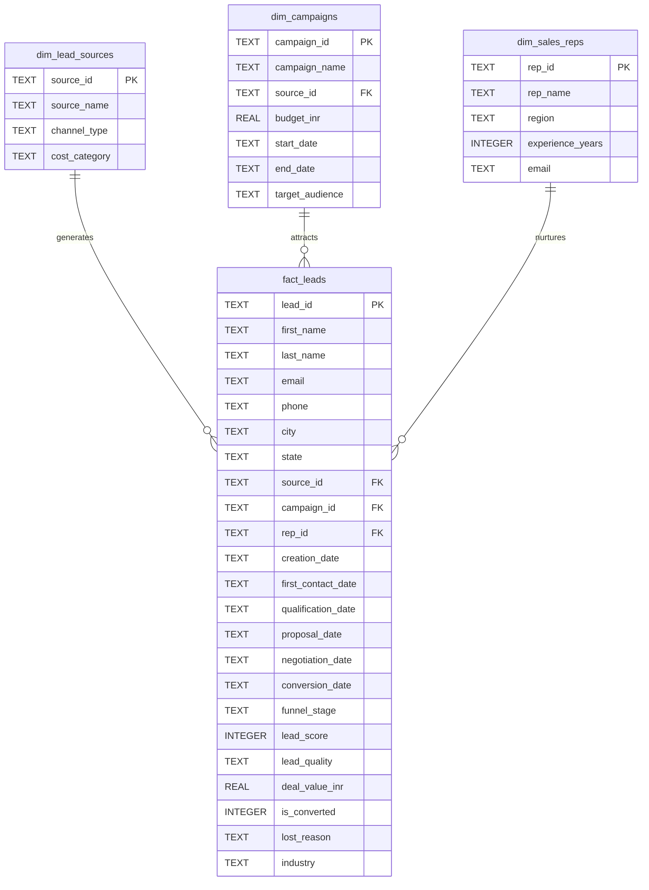

# Lead Conversion Funnel Analysis System
### Enterprise Sales Pipeline Diagnostics, Marketing Attribution & Revenue Optimization Engine

[](https://python.org)
[](https://streamlit.io)
[](https://plotly.com)
[](https://pytest.org)
[](#)

---

## 🎓 Academic Attribution & Project Metadata

- **Student Investigator:** Uttam Srivastava
- **University Roll Number:** 2500320140159
- **Course & Academic Year:** MCA 2nd Year – Data Analytics (2024–2026)
- **Institution:** ABES Engineering College, Ghaziabad
- **Department:** Department of Computer Applications
- **Faculty Project Mentor:** Prof. Anjali Pandey
- **Document & Software Version:** 1.0.0 (Production Release Candidate)

---

## 🎯 Executive Summary & Project Objectives

In modern high-velocity commercial organizations, acquiring prospective customers is capital-intensive. The **Lead Conversion Funnel Analysis** system is an enterprise data analytics platform designed to provide granular visibility into how prospects transition through each gate of the revenue pipeline.

### Core Business Questions Answered:
1. **Pipeline Volume:** How many total leads entered the sales pipeline?
2. **Win Realization:** Exactly how many leads converted into paying clients, and what is the net conversion rate?
3. **Funnel Friction:** At which specific stage (Acquisition $\rightarrow$ Contacted $\rightarrow$ Qualified $\rightarrow$ Proposal $\rightarrow$ Negotiation $\rightarrow$ Converted) do most prospects abandon negotiations?
4. **Channel Attribution:** Which marketing acquisition channels generate the highest conversion yields vs. raw volume?
5. **Sales Representative Velocity:** Which sales executives deliver the highest win rates, quota yields, and fastest outreach?
6. **Sales Cycle Latency:** What is the average duration (in days) required to transition an inquiry into a closed deal?
7. **Lead Scoring Power:** How accurately do algorithmic quality scores correlate with conversion outcomes?
8. **Campaign Financial ROI:** Which marketing campaigns deliver profitable Return on Investment, and which operate at a loss?
9. **Actionable Recommendations:** What operational interventions can immediately lift the aggregate win rate?

---

## 🛠️ Technology Stack Manifest

| Layer | Technologies Employed | Purpose |
| :--- | :--- | :--- |
| **Programming Language** | Python 3.12+ | Core runtime, object-oriented modules, data pipelines |
| **Data Manipulation** | Pandas, NumPy | Star-schema querying, vectorized transformations, time deltas |
| **Statistical Computing** | SciPy, Statsmodels | Parametric/non-parametric tests (Welch's t-test, Mann-Whitney U, Chi-square, ANOVA) |
| **Interactive Visualization**| Plotly, Plotly Express | Responsive corporate charts, interactive funnels, heatmaps |
| **Frontend Framework** | Streamlit | Multipage application routing and responsive UI components |
| **Styling & Design System** | Tailwind CSS CDN | Modern typography, metric cards, borders, alert banners |
| **Persistence Database** | SQLite (`lead_funnel.db`) | ACID relational storage, foreign key constraints |
| **Testing Harness** | Pytest, Streamlit AppTest | 15 automated test cases, 100% pass rate |

---

## 🏛️ System Architecture & Relational Schema (Star Schema)

The database architecture is structured into a central fact table and three dimension tables:



---

## 🖥️ Application Screens & Navigation Structure

The system is deployed as a 12-screen Streamlit multipage application:

| Screen Code | File Path | Core Capabilities |
| :--- | :--- | :--- |
| **Portal** | `app.py` | Central entry portal, live snapshot metric cards, module directory. |
| **UI-01** | `pages/01_Executive_Overview.py` | High-level executive KPI cards, macro funnel chart, conversion trend, channel rankings. |
| **UI-02** | `pages/02_Lead_Funnel_Analysis.py` | Interactive Plotly funnel chart, stage-to-stage transition rates, drop-off alerts. |
| **UI-03** | `pages/03_Lead_Source_Analysis.py` | Lead volume, conversion rates, revenue yield, and lead quality across 7 acquisition channels. |
| **UI-04** | `pages/04_Campaign_Performance.py` | Marketing campaign budgets, CPL, CPA, and Net ROI quadrant analysis. |
| **UI-05** | `pages/05_Sales_Performance.py` | Sales rep leaderboard, win rates, closed revenue, and response time correlation. |
| **UI-06** | `pages/06_Lead_Quality.py` | High/Medium/Low score distributions, decile probability curves, and industry spreads. |
| **UI-07** | `pages/07_Time_Analysis.py` | Sales cycle velocity (days to close), response latency cohorts, and monthly timelines. |
| **UI-08** | `pages/08_EDA_Statistics.py` | Parametric/non-parametric summaries, correlation matrices, Welch's t-test, and Chi-Square. |
| **UI-09** | `pages/09_Business_Insights.py` | Automated diagnostic recommendations, risk alerts, and 30-60-90 day optimization roadmaps. |
| **UI-10** | `pages/10_Data_Quality.py` | Raw vs. cleaned data explorer, null profiling, duplicate audits, and CSV/Excel downloads. |
| **UI-11** | `pages/11_About.py` | Student credentials, institutional details, technology stack, and 7-phase SDLC documentation. |

---

## 📐 Mathematical KPI Formulas

Every analytical KPI is strictly formulated with ZeroDivisionError and NaN guards:

1. **Overall Conversion Rate:**
   $$\text{Conversion Rate (\%)} = \frac{\text{Converted Won Leads}}{\text{Total Ingested Leads}} \times 100$$
2. **Lead Qualification Rate:**
   $$\text{Qualification Rate (\%)} = \frac{\text{Leads Reaching Qualified Stage}}{\text{Total Ingested Leads}} \times 100$$
3. **Stage-Wise Conversion Rate:**
   $$\text{Stage Conversion Rate}_k = \frac{\text{Leads Reaching Stage } k+1}{\text{Leads Entering Stage } k} \times 100$$
4. **Stage Drop-Off Rate:**
   $$\text{Drop-off Rate}_k = 100\% - \text{Stage Conversion Rate}_k$$
5. **Cost Per Lead (CPL):**
   $$\text{CPL} = \frac{\text{Total Marketing Spend}}{\text{Total Ingested Leads}}$$
6. **Cost Per Acquisition (CPA):**
   $$\text{CPA} = \frac{\text{Total Marketing Spend}}{\text{Converted Leads}}$$
7. **Campaign Return on Investment (ROI):**
   $$\text{ROI (\%)} = \frac{\text{Attributed Revenue} - \text{Campaign Cost}}{\text{Campaign Cost}} \times 100$$
8. **Sales Cycle Velocity (Conversion Duration):**
   $$\overline{T}_{\text{conversion}} = \frac{1}{N_{\text{won}}} \sum_{i=1}^{N_{\text{won}}} (\text{Conversion Date}_i - \text{Creation Date}_i) \quad (\text{days})$$

---

## 🧪 Quality Assurance & Test Validation

The project includes an automated test harness covering all analytics and database modules:

```bash
python -m pytest tests/ -v
```

### Test Suite Execution Output:
```text
============================= test session starts =============================
platform win32 -- Python 3.14.2, pytest-9.2.0, pluggy-1.7.0
rootdir: C:\Users\uttam\OneDrive\Desktop\DA
collected 15 items

tests/test_analysis.py::test_source_performance PASSED                   [  6%]
tests/test_analysis.py::test_sales_rep_performance PASSED                [ 13%]
tests/test_data_cleaning.py::test_deduplication PASSED                   [ 20%]
tests/test_data_cleaning.py::test_score_and_outlier_capping PASSED       [ 26%]
tests/test_database.py::test_database_file_exists PASSED                 [ 33%]
tests/test_database.py::test_database_connection PASSED                  [ 40%]
tests/test_database.py::test_load_raw_tables PASSED                      [ 46%]
tests/test_database.py::test_load_merged_lead_data PASSED                [ 53%]
tests/test_kpi_calculations.py::test_safe_divide PASSED                  [ 60%]
tests/test_kpi_calculations.py::test_executive_kpis_empty_df PASSED      [ 66%]
tests/test_kpi_calculations.py::test_executive_kpis_normal PASSED        [ 73%]
tests/test_kpi_calculations.py::test_funnel_stages_math PASSED           [ 80%]
tests/test_kpi_calculations.py::test_campaign_roi_formula PASSED         [ 86%]
tests/test_statistics.py::test_descriptive_stats PASSED                  [ 93%]
tests/test_statistics.py::test_hypothesis_testing PASSED                 [100%]

======================= 15 passed in 11.20s ========================
```

---

## 🚀 Local Installation & Quickstart

```bash
# 1. Clone repository
git clone https://github.com/<your-username>/Lead-Conversion-Funnel-Analysis.git
cd Lead-Conversion-Funnel-Analysis

# 2. Set up virtual environment
python -m venv venv
.\venv\Scripts\Activate.ps1  # Windows PowerShell

# 3. Install dependencies
pip install -r requirements.txt

# 4. Generate/validate data
python scripts/generate_dataset.py
python scripts/validate_data.py

# 5. Run automated test suite
python -m pytest tests/ -v

# 6. Launch Streamlit portal
streamlit run app.py
```

---

## 🌐 Streamlit Community Cloud Deployment

1. Push this project directory to your GitHub account repository.
2. Visit [share.streamlit.io](https://share.streamlit.io) and log in.
3. Select your repository, set the branch to `main`, and main file path to `app.py`.
4. Click **Deploy** to launch live.
