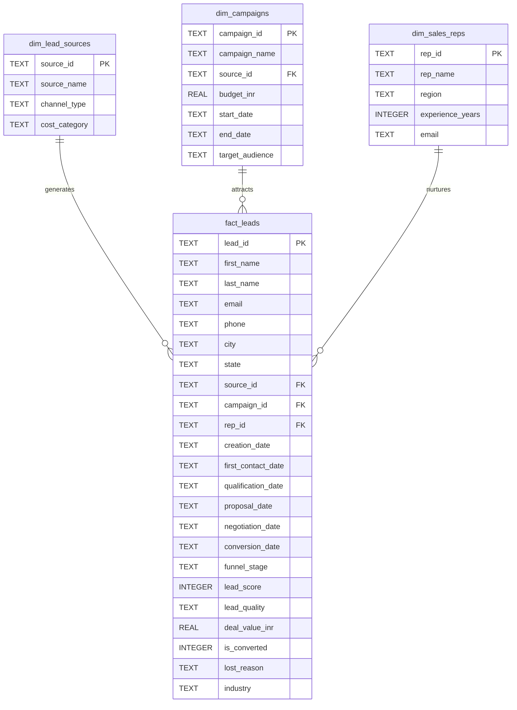

# PHASE 3: Technical Design & Data Dictionary
## Lead Conversion Funnel Analysis System

**Author:** Uttam Srivastava (Roll: 2500320140159)  
**Program:** MCA 2nd Year – Data Analytics, ABES Engineering College  
**Faculty Guide:** Prof. Anjali Pandey  
**Document Version:** 1.0.0  

---

### 1. System Architecture Overview

The system follows a modern multi-tier decoupled architecture:
1. **Persistence Layer (Database):** SQLite database (`lead_funnel.db`) adhering to Star Schema dimensional design principles.
2. **Data Ingestion & Cleaning Layer (`src/database.py`, `src/data_cleaning.py`):** Connection pool management, SQL extraction, automated deduplication, null-handling, type casting, and anomaly flagging.
3. **Analytics & Statistical Engine (`src/analysis.py`, `src/statistics.py`):** Pure Python business logic computing funnel transitions, marketing ROI, sales rep quotas, correlation matrices, and inferential hypothesis testing (Student t-test, Mann-Whitney U, Chi-Square contingency).
4. **Presentation & Visualization Layer (`src/visualization.py`, `src/components.py`):** Plotly visualization generators styled with a unified corporate colorway, combined with Streamlit UI components enriched with Tailwind CSS CDN for premium SaaS-style metric cards and responsive layouts.
5. **Multipage Application Routing (`app.py`, `pages/01_*.py` to `pages/11_*.py`):** Seamless multi-screen navigation adhering to enterprise software design standards.

```
+-------------------------------------------------------------------------------+
|                             Presentation Layer                                |
|  Streamlit Multipage UI (app.py + 11 Specialized Pages) + Tailwind CSS CDN    |
|   - Executive Overview       - Funnel Analysis       - Lead Source Attribution|
|   - Campaign Performance     - Sales Rep Performance - Lead Quality & Scoring |
|   - Time & Velocity Analysis - Statistical EDA       - Business Insights      |
|   - Data Quality Auditor     - Project / Academic Metadata                     |
+---------------------------------------+---------------------------------------+
                                        |
+---------------------------------------v---------------------------------------+
|                    Visualizations & UI Components Engine                      |
|            src/visualization.py  |  src/components.py (Plotly + HTML/CSS)     |
+---------------------------------------+---------------------------------------+
                                        |
+---------------------------------------v---------------------------------------+
|                       Analytical & Statistical Engine                         |
|     src/analysis.py (KPI Formulas, Funnel Math, Attribution, ROI Matrix)      |
|     src/statistics.py (SciPy, Statsmodels, Correlations, Hypothesis Testing)  |
+---------------------------------------+---------------------------------------+
                                        |
+---------------------------------------v---------------------------------------+
|                       Data Access & Cleaning Engine                           |
|       src/data_loader.py  |  src/data_cleaning.py (Deduplication, Imputation) |
+---------------------------------------+---------------------------------------+
                                        |
+---------------------------------------v---------------------------------------+
|                         Persistence & Raw Storage                             |
|          SQLite (lead_funnel.db)  |  Raw CSVs  |  Excel Multi-Sheet Workbook  |
+-------------------------------------------------------------------------------+
```

---

### 2. Relational Database Schema Design (Star Schema)

The database schema is structured into four primary relational tables:
- **`dim_lead_sources`** (Dimension): Marketing channels and acquisition vectors.
- **`dim_campaigns`** (Dimension): Specific marketing initiatives, start/end dates, and budgets.
- **`dim_sales_reps`** (Dimension): Sales executives, regional territory, and experience level.
- **`fact_leads`** (Fact): Central transactional record detailing individual lead journeys, timestamp milestones, scores, deal values, and conversion outcomes.

#### Entity Relationship Diagram (ERD - Mermaid)



---

### 3. Data Dictionary

#### 3.1 Table: `dim_lead_sources`
| Column Name | Data Type | Constraint | Description | Example Values |
| :--- | :--- | :--- | :--- | :--- |
| `source_id` | TEXT | PRIMARY KEY | Unique source identifier | `SRC-01`, `SRC-02` |
| `source_name` | TEXT | NOT NULL | Marketing channel name | `Website`, `Social Media`, `Organic Search` |
| `channel_type` | TEXT | NOT NULL | Channel inbound/outbound type | `Inbound`, `Outbound`, `Referral` |
| `cost_category`| TEXT | NOT NULL | Expense classification | `Paid`, `Organic`, `Hybrid` |

#### 3.2 Table: `dim_campaigns`
| Column Name | Data Type | Constraint | Description | Example Values |
| :--- | :--- | :--- | :--- | :--- |
| `campaign_id` | TEXT | PRIMARY KEY | Unique campaign identifier | `CMP-01`, `CMP-02` |
| `campaign_name` | TEXT | NOT NULL | Marketing campaign title | `SaaS Growth Sprint Q1`, `Diwali Festive Boost` |
| `source_id` | TEXT | FOREIGN KEY | Associated marketing channel | `SRC-01`, `SRC-04` |
| `budget_inr` | REAL | NOT NULL | Total allocated campaign spend in ₹ | `150000.0`, `350000.0` |
| `start_date` | TEXT | NOT NULL | Campaign launch date | `2024-01-01` |
| `end_date` | TEXT | NOT NULL | Campaign end date | `2024-03-31` |
| `target_audience`| TEXT | NULL | Target demographic or industry | `B2B Decision Makers`, `Enterprise Tech` |

#### 3.3 Table: `dim_sales_reps`
| Column Name | Data Type | Constraint | Description | Example Values |
| :--- | :--- | :--- | :--- | :--- |
| `rep_id` | TEXT | PRIMARY KEY | Unique sales executive ID | `REP-01`, `REP-02` |
| `rep_name` | TEXT | NOT NULL | Sales executive full name | `Aarav Sharma`, `Pooja Verma` |
| `region` | TEXT | NOT NULL | Assigned geographical territory | `North`, `South`, `West`, `East` |
| `experience_years`| INTEGER | NOT NULL | Professional sales experience | `3`, `5`, `8` |
| `email` | TEXT | NOT NULL | Corporate email address | `aarav.sharma@corp.in` |

#### 3.4 Table: `fact_leads`
| Column Name | Data Type | Constraint | Description | Example Values |
| :--- | :--- | :--- | :--- | :--- |
| `lead_id` | TEXT | PRIMARY KEY | Unique lead tracking code | `LEAD-1001`, `LEAD-1002` |
| `first_name` | TEXT | NOT NULL | Lead first name (fictional Indian) | `Rohan`, `Neha`, `Vikram` |
| `last_name` | TEXT | NOT NULL | Lead last name (fictional Indian) | `Gupta`, `Nair`, `Patel` |
| `email` | TEXT | NULL (2-3% null) | Lead email address | `rohan.gupta@bizmail.in` |
| `phone` | TEXT | NULL (2-3% null) | Phone contact number | `+91 98765 43210` |
| `city` | TEXT | NOT NULL | Lead city | `Bengaluru`, `Mumbai`, `Delhi NCR` |
| `state` | TEXT | NOT NULL | Lead state | `Karnataka`, `Maharashtra`, `Delhi` |
| `source_id` | TEXT | FOREIGN KEY | Ingestion source ID | `SRC-01` |
| `campaign_id` | TEXT | FOREIGN KEY | Associated marketing campaign | `CMP-02` |
| `rep_id` | TEXT | FOREIGN KEY | Assigned sales representative | `REP-03` |
| `creation_date` | TEXT | NOT NULL | Funnel entry date | `2024-02-14` |
| `first_contact_date`| TEXT | NULL | Date sales rep reached out | `2024-02-15` |
| `qualification_date`| TEXT | NULL | Date lead passed BANT qualification | `2024-02-18` |
| `proposal_date` | TEXT | NULL | Date formal proposal was submitted | `2024-02-24` |
| `negotiation_date`| TEXT | NULL | Date pricing negotiation commenced | `2024-03-02` |
| `conversion_date`| TEXT | NULL | Date deal closed won (or lost) | `2024-03-10` |
| `funnel_stage` | TEXT | NOT NULL | Deepest funnel stage reached | `Converted`, `Negotiation`, `Lost` |
| `lead_score` | INTEGER | NOT NULL | Algorithmic quality score (1-100) | `84`, `42`, `91` |
| `lead_quality` | TEXT | NOT NULL | Quality tier: High, Medium, Low | `High`, `Medium`, `Low` |
| `deal_value_inr` | REAL | NULL | Value of closed deal (or projected) | `175000.0`, `320000.0` |
| `is_converted` | INTEGER | NOT NULL | Binary conversion flag (1=Won, 0=Lost/In Progress)| `1`, `0` |
| `lost_reason` | TEXT | NULL | Reason lead dropped out of funnel | `Price too high`, `Chose competitor` |
| `industry` | TEXT | NOT NULL | Target industry sector | `FinTech`, `EdTech`, `Healthcare` |

---

### 4. Mathematical KPI Formulas & Definitions

1. **Overall Conversion Rate ($CR_{\text{overall}}$):**
   $$CR_{\text{overall}} = \left( \frac{\sum \text{is\_converted}}{\text{Total Ingested Leads}} \right) \times 100$$
   *Division by zero safeguard:* If $\text{Total Leads} = 0$, $CR = 0.0\%$.

2. **Lead Qualification Rate ($QR$):**
   $$QR = \left( \frac{\text{Leads Reaching Qualification Stage}}{\text{Total Ingested Leads}} \right) \times 100$$

3. **Stage-Wise Conversion Rate ($CR_k$):**
   $$CR_k = \left( \frac{N_{k+1}}{N_k} \right) \times 100$$
   Where $N_k$ is the number of leads that entered Stage $k$, and $N_{k+1}$ is the count that progressed to Stage $k+1$.

4. **Stage Drop-Off Rate ($DO_k$):**
   $$DO_k = 100\% - CR_k = \left( \frac{N_k - N_{k+1}}{N_k} \right) \times 100$$

5. **Average Deal Value ($ADV$):**
   $$ADV = \frac{\sum_{i \in \text{Converted}} \text{Deal\_Value}_i}{N_{\text{converted}}}$$

6. **Cost Per Lead ($CPL$):**
   $$CPL = \frac{\text{Total Marketing Spend}}{\text{Total Leads Generated}}$$

7. **Cost Per Acquisition ($CPA$):**
   $$CPA = \frac{\text{Total Marketing Spend}}{N_{\text{converted}}}$$

8. **Campaign Return on Investment ($ROI$):**
   $$ROI = \left( \frac{\text{Attributed Converted Revenue} - \text{Campaign Cost}}{\text{Campaign Cost}} \right) \times 100$$

9. **Conversion Cycle Velocity ($\overline{T}_{\text{conversion}}$):**
   $$\overline{T}_{\text{conversion}} = \frac{1}{N_{\text{converted}}} \sum_{i=1}^{N_{\text{converted}}} \left( \text{Conversion Date}_i - \text{Creation Date}_i \right) \quad (\text{in days})$$

10. **Sales Rep Initial Response Latency ($\overline{T}_{\text{response}}$):**
   $$\overline{T}_{\text{response}} = \frac{1}{N_{\text{contacted}}} \sum_{i=1}^{N_{\text{contacted}}} \left( \text{First Contact Date}_i - \text{Creation Date}_i \right) \quad (\text{in days})$$
